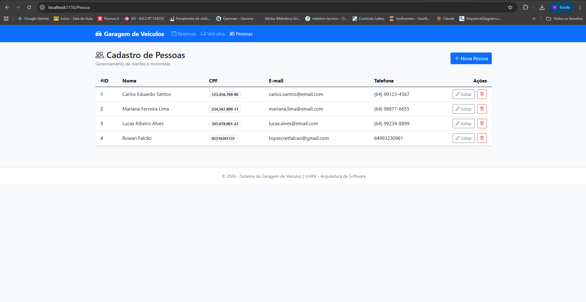
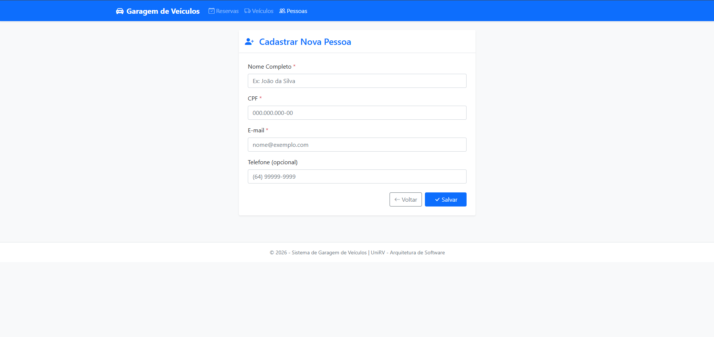
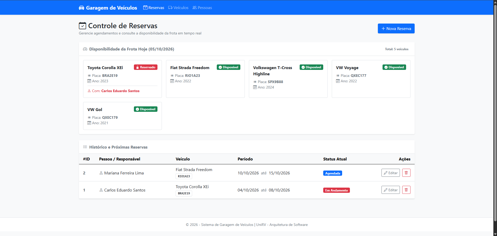
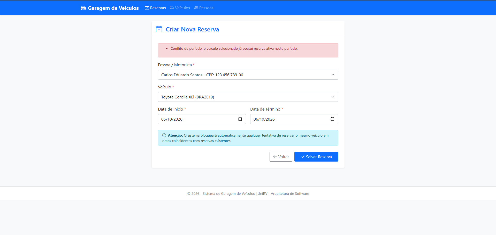

# Sistema de Garagem de Veiculos

Projeto pratico desenvolvido para a disciplina de Arquitetura de Software (ESW430) da Universidade de Rio Verde (UniRV).

## Integrantes do Grupo
- Rowan Falcao Rodrigues Lopes Da Silva
- Marcio Henrique Lenz

## Tecnologias e Arquitetura

- Linguagem e Framework: C# / .NET 8 (ASP.NET Core MVC)
- Padrao de Arquitetura: Model-View-Controller (MVC)
- Persistencia de Dados: Arquivos JSON no diretorio Data/ (pessoas.json, veiculos.json, reservas.json)
- Padroes de Projeto e Boas Praticas:
  - Repository Pattern: Desacoplamento entre a camada de persistencia e a logica de apresentacao.
  - Injecao de Dependencia (DI): Registro via builder.Services.AddScoped<Interface, Implementacao>() e injecao por construtor nos Controllers.
  - Principios SOLID:
    - Single Responsibility Principle (SRP): Controllers lidam exclusivamente com requisicoes HTTP e roteamento; Repositorios sao responsaveis pela persistencia e validacoes de armazenamento.
    - Dependency Inversion Principle (DIP): Controllers dependem de abstracoes (IPessoaRepository, IVeiculoRepository, IReservaRepository), nunca de classes concretas ou new.
    - Open/Closed e Liskov: Facilidade para trocar a implementacao de repositorio (ex: JSON para Banco de Dados) sem alterar os Controllers.
- Frontend / UI: Bootstrap 5, Bootstrap Icons, HTML5 Semantico e Razor Views.

## Demonstracao das Telas (Prints do Sistema)

### 1. Modulo de Pessoas
| Listagem de Pessoas | Formulario de Cadastro/Edicao |
| :---: | :---: |
|  |  |

### 2. Modulo de Reservas (Pagina Inicial e Conflito)
| Pagina Inicial de Reservas | Bloqueio por Conflito de Data |
| :---: | :---: |
|  |  |

## Estrutura de Pastas e Componentes

Cada entidade possui obrigatoriamente 5 componentes bem delimitados:

GaragemVeiculos/
├── Controllers/
│   ├── PessoaController.cs       # Controller de Pessoas
│   ├── VeiculoController.cs      # Controller de Veiculos
│   └── ReservaController.cs      # Controller de Reservas (Pagina Inicial)
├── Models/
│   ├── Pessoa.cs                 # Model com DataAnnotations
│   ├── Veiculo.cs                # Model com validacao de placa e ano
│   ├── Reserva.cs                # Model de agendamento de veiculos
│   └── ReservaViewModels.cs      # ViewModels para status e telas ricas
├── Repositories/
│   ├── IPessoaRepository.cs      # Interface do repositorio de pessoas
│   ├── PessoaRepository.cs       # Implementacao JSON com auto-incremento de ID e unicidade de CPF
│   ├── IVeiculoRepository.cs     # Interface do repositorio de veiculos
│   ├── VeiculoRepository.cs      # Implementacao JSON com unicidade de placa
│   ├── IReservaRepository.cs     # Interface do repositorio de reservas
│   └── ReservaRepository.cs      # Implementacao JSON com validacao de conflito de periodo
├── Data/
│   ├── pessoas.json              # Base de dados de pessoas
│   ├── veiculos.json             # Base de dados de veiculos
│   └── reservas.json             # Base de dados de reservas
├── Views/
│   ├── Pessoa/
│   │   ├── Index.cshtml          # Listagem com confirmacao de exclusao
│   │   └── PessoaForm.cshtml     # Formulario de cadastro/edicao
│   ├── Veiculo/
│   │   ├── Index.cshtml          # Listagem com badges de identificacao
│   │   └── VeiculoForm.cshtml    # Formulario de cadastro/edicao
│   ├── Reserva/
│   │   ├── Index.cshtml          # Painel inicial com status hoje e listagem
│   │   └── ReservaForm.cshtml    # Formulario com comboboxes e validacoes
│   └── Shared/
│       └── _Layout.cshtml        # Layout responsivo com menu superior e feedback visual
├── Program.cs                    # Configuracao de rotas e DI
└── GaragemVeiculos.csproj        # Configuracao do projeto .NET 8

## Regra de Negocio de Conflito de Periodo

A verificacao de sobreposicao de datas de reserva do mesmo veiculo e realizada na camada de repositorio (IReservaRepository.ExisteConflito):

novaInicio <= existenteFim AND novaFim >= existenteInicio

* Na edicao de uma reserva existente, o proprio Id e desconsiderado para permitir alteracoes de datas pelo usuario.
* O sistema impede a gravacao se DataFim < DataInicio e caso haja choque de datas com outra reserva do mesmo veiculo.
* A tela inicial (/) exibe um painel de disponibilidade em tempo real indicando se cada veiculo da frota esta Disponivel ou Reservado na data atual.

## Como Executar a Aplicacao

### Pre-requisitos:

* .NET 8.0 SDK instalado.

### Passos:

1. Abra um terminal na pasta raiz do projeto:
cd "GaragemVeiculos"
2. Restaure as dependencias e compile o projeto:
dotnet build
3. Execute a aplicacao:
dotnet run
4. Abra seu navegador no endereco:
* HTTP: http://localhost:5150

## Ferramentas de Inteligencia Artificial Utilizadas

* Antigravity IDE (DeepMind / Google): Utilizado como assistente de arquitetura e pair programming para auditoria de codigo, garantia de cumprimento rigoroso dos principios SOLID e Repository Pattern, refatoracao de componentes Razor, criacao de testes e documentacao.
